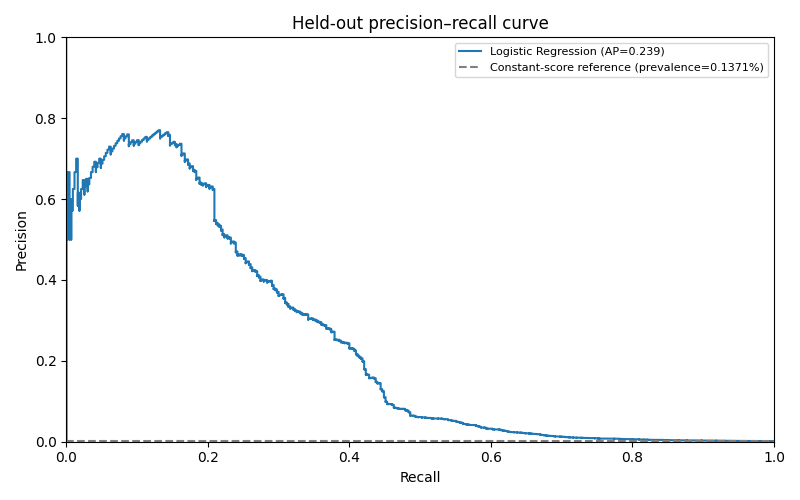

# E-commerce customer journeys and next-day purchase prediction

Retailrocket records what shoppers view, add to their cart and buy. This project
looks at where visitors leave the shopping journey, then uses their recent
activity to predict whether they will buy something the next day.

**Python · SQL/SQLite · pandas · scikit-learn**

[](https://github.com/Cheng-Chi-Wu/ecommerce-conversion-ml/actions/workflows/tests.yml)

## Results

<!-- RESULTS:START -->

The analysis starts with **2,756,101 events** from
**1,407,580 visitors**. SQL finds **69.87%**
cart-event abandonment: no later same-item purchase within 24 hours, among carts
with complete follow-up. Repeated additions count as separate cart events.

The prediction dataset has **1,634,383 visitor-day snapshots**. The test
period has **313,534 snapshots**, of which **430** include a
next-day purchase (**0.1371%** prevalence).

| Model | Validation AP | Test AP | Test precision, top 1% |
| --- | --- | --- | --- |
| Naive prevalence baseline | 0.0013 | 0.0014 | 0.06% |
| Logistic Regression | 0.2492 | 0.2392 | 6.66% |
| Random Forest | 0.2349 | 0.2405 | 6.25% |

**Logistic Regression** was selected using validation AP. Its top
**3,136** test snapshots contain **6.66%** purchasers.
AP means average precision; the top-1% column measures ranking at a fixed capacity.

<!-- RESULTS:END -->



The model finds a group with a higher purchase rate. Whether a reminder would
actually help them buy is a separate question. To answer that, a later experiment
would need to randomly assign visitors to receive a reminder or receive none.

[Full results, funnel and error analysis](reports/results.md)

## How the analysis is set up

**Make one prediction per day.** At midnight, the model uses the previous day's
activity to predict purchases in the next 24 hours. This gives the analysis a
clear cutoff, but it leaves out purchases that happened before midnight.
The results are most relevant to reaching visitors who might return the next day.

**Choose the model before looking at test results.** Logistic Regression did
better on validation. Random Forest ended up slightly ahead on test AP, but the
selection stays with Logistic Regression: the test period is there to evaluate
the earlier choice. The data is split by date, with a one-day gap between periods
to keep purchase outcomes from overlapping.

**Use the category known at the time.** Category records change over time.
Some shopping events happened before a category was recorded for the item.
Those events stay unknown; using a later record would give the analysis
information it could not have had then.

[Method and tradeoffs](reports/methodology.md) ·
[Feature definitions and SQL details](docs/technical_notes.md)

## Read the analysis and code

| Question | Notebook or implementation |
| --- | --- |
| How are the funnel and abandonment measured? | [Analytics notebook](notebooks/01_customer_journey.ipynb) · [Funnel SQL](sql/01_funnel.sql) · [Abandonment SQL](sql/02_conversion.sql) |
| How are past behavior and future labels separated? | [Feature construction](src/features.py) · [Temporal boundary tests](tests/test_features.py) |
| How are models compared and selected? | [Model notebook](notebooks/02_conversion_model.ipynb) · [Training and evaluation](src/modeling.py) |
| How do the pieces fit together? | [Pipeline entry point](src/pipeline.py) · [Stage inputs and outputs](docs/technical_notes.md#pipeline) |

Start with the notebooks for a walkthrough of the results. The Python code is
in `src/`, and the analysis queries are in `sql/`. Reports contain summary tables
and checks from the local run. Raw events, individual visitor predictions,
trained models and the local Python environment are excluded from Git.

## Run locally

Download the four CSVs from the [Retailrocket dataset](https://www.kaggle.com/datasets/retailrocket/ecommerce-dataset)
and place them in `data/raw/` with their original filenames. Use Python 3.9+
and allow several GB of RAM and disk space; the SQLite database is about 2.1 GB.

```bash
python3 -m venv .venv
source .venv/bin/activate
python -m pip install -r requirements-notebooks.txt
python -m pytest -q
python -m src.pipeline all
```

The tests use small fixtures and do not require the dataset. GitHub Actions runs
the same test suite. [Technical notes](docs/technical_notes.md#reproduction)
cover individual pipeline stages, notebook execution and batch scoring.

## Limits and next step

The data comes from 2015, and product and visitor details are anonymized. It does
not provide usable revenue figures or the cost and outcome of contacting a
customer. The model scores work for ranking; they should not be read as exact
purchase probabilities. There are only 430 positive examples in the test period,
so the reported performance still has considerable uncertainty.

A useful next step is to try predictions more often than once a day, compare
them on validation data, and check the chosen approach on a new future test
period. That comparison and a customer-contact experiment are still future work.

## Putting the pieces together

I understood data processing, SQL, machine learning and how to read the plots.
The harder part was connecting them into a complete project: getting the data
ready, passing it into the model, and bringing the results back into the analysis.
That integration was the main learning focus here.

I used AI assistance to organize the overall workflow, explain the pipeline,
help with the README and code comments, and suggest analyses and charts.
The [pipeline notes](docs/technical_notes.md#pipeline) show how each stage passes
its outputs to the next.

## Data and license

Retailrocket supplied the dataset; its listing displays CC BY-NC-SA 4.0.
Original project code uses the MIT license; dataset-derived reports and figures
retain the dataset terms. See [data attribution](DATA_SOURCE.md) and
[code license](LICENSE).
