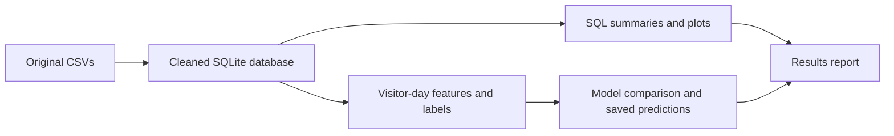

# Technical notes

Implementation details for the SQL analysis and next-day purchase model.

## Pipeline

The pieces communicate through saved files. [pipeline.py](../src/pipeline.py)
calls the stages in order; each stage reads the outputs it needs from earlier
stages. The SQL analysis and feature construction both start from the cleaned
database. The model does not train on the aggregate SQL report tables.



| Stage | Reads | Writes | Code |
| --- | --- | --- | --- |
| `ingest` | Four CSVs in `data/raw/` | `data/processed/retailrocket.sqlite`, data audit | [ingest.py](../src/ingest.py) |
| `sql` | SQLite database and the queries in `sql/` | Aggregate CSVs and journey plots in `reports/` | [analytics.py](../src/analytics.py) |
| `features` | Events with their historical categories | `data/processed/visitor_snapshots.pkl`, split audit | [features.py](../src/features.py) |
| `train` | Snapshots with train/validation/test assignments | Model bundle, test predictions, metrics and model plots | [modeling.py](../src/modeling.py) |
| `report` | Data audit, SQL outputs, model outputs and snapshots | Error tables, run metadata, detailed results and README summary | [reporting.py](../src/reporting.py) · [evaluation.py](../src/evaluation.py) |

The notebooks provide a walkthrough after these files have been generated.
They run SQL and inspect model results; they do not replace the training stage.
The saved model includes its preprocessing, so batch scoring uses the same
transformation as training.

## Category and item summary

`reports/04_product_category.csv` contains four groups: the top 20 known
categories, top 20 items, the top 20 known categories with at least 1,000
visitors, and one unknown-category row. Each ranked group is sorted by
`transaction_events` descending, then numeric category/item ID ascending for
ties. Unknown categories are excluded from category rankings and reported
separately. The visitor-filtered group supports the five-category table in
the results and analytics notebook. Groups overlap and must not be added together.

| Column | Meaning |
| --- | --- |
| `summary_group` | `top_categories`, `top_items`, `categories_1000_visitors` or `unknown_category` |
| `rank` | Position within a ranked group; blank for unknown categories |
| `grain` | `category` or `product` (an item) |
| `entity` | Numeric category/item ID, or `unknown` |
| `views`, `carts` | View and cart-addition event counts |
| `transaction_events` | Purchased-item events, not distinct orders |
| `visitors` | Distinct visitors observed for that entity |
| `visitor_conversion_rate` | Visitors with a transaction for that entity / all its observed visitors |

Running `python -m src.pipeline sql` also produces the complete category/item
detail at `data/processed/04_product_category_full.csv`. It is Git-ignored.
[category_summary.json](../reports/category_summary.json) records the group
definitions, ranking rule and full/summary row counts. Visitor denominators
can overlap across items and categories.

## Database schema

All timestamps are integer Unix **milliseconds in UTC**. Nullable transaction
IDs on views/carts and parent IDs on root categories are structural, not
imputation targets. An event transaction row represents an item interaction;
several rows can belong to one transaction ID. Event counts are not order counts.

| Table | Grain / key | Main fields |
| --- | --- | --- |
| `events` | Deduplicated event; `event_id` | timestamp, visitorid, event, itemid, nullable transactionid |
| `item_properties` | Original property-change row | timestamp, itemid, property, value, source_file |
| `categories` | Category; `categoryid` | nullable parentid |
| `category_history` | Item + effective timestamp | categoryid |
| `event_categories` | Event; `event_id` | event fields, nullable categoryid and category_timestamp |

See [schema.sql](../sql/schema.sql). Catalog relationships are logical rather than
enforced foreign keys because coverage is incomplete. Exact event duplicates
are removed; raw property rows are retained. Category changes are deduplicated,
and conflicting category values at the same item/time stop ingestion. The
database is replaced only after row-count and SQLite integrity checks pass.

## SQL analysis

| Query | Definition |
| --- | --- |
| [Funnel](../sql/01_funnel.sql) | Unique visitors with a view, then a strictly later cart, then a strictly later transaction in the capture period; can span sessions and items |
| [Conversion and abandonment](../sql/02_conversion.sql) | Any purchasing visitor / any visitor; eligible cart events without a strictly later same-item purchase within 24h / eligible cart events |
| [Returning visitors](../sql/03_returning_visitors.sql) | Active on at least two observed UTC dates; retrospective segment, not an ML feature |
| [Product/category performance](../sql/04_product_category.sql) | Views, carts, transaction item events and purchasing visitor rates; categories joined at event time |
| [Daily/weekly trends](../sql/05_trends.sql) | UTC dates and Monday-start weeks, event counts and within-period visitor conversion |

Abandonment excludes carts without a full 24h follow-up at the capture boundary.
There is no cart ID; repeated cart additions are separate events and can share
one future purchase. Unknown categories remain explicit. Visitor denominators
overlap across products/categories and should not be summed. First/last daily
and weekly buckets can be partial; interpret boundary trends accordingly.

## ML methodology

**Unit:** one visitor at a fixed UTC midnight `t`, eligible only if active in the
prior 24h. The prediction is whether any transaction occurs in `(t, t+24h]`.
No future activity is required for eligibility. This policy primarily captures
next-day returning purchases; it excludes first-visit purchases completed before
the next cutoff. Its positive rate is therefore lower than full-period conversion.

| Feature | Definition and business hypothesis |
| --- | --- |
| `views_1h`, `views_24h` | Views in `(t-1h,t]` and `(t-24h,t]`; recent engagement |
| `unique_items_viewed_24h` | Distinct viewed items in prior 24h; breadth of exploration |
| `repeat_views_24h` | Views minus unique viewed items; repeated consideration |
| `cart_additions_24h` | Cart event count in prior 24h; purchase intent |
| `last_session_duration_minutes` | First-to-last observed event in latest session; engagement depth |
| `category_diversity_24h` | Distinct known event-time categories viewed; breadth of interests |
| `unknown_category_views_24h` | Views with unavailable event-time metadata; missingness signal |
| `previous_transactions` | All transaction item events observed through `t`; historical buying |
| `hours_since_last_event` | Time from most recent observed event to `t`; recency |

Sessions use a gap **greater than 30 minutes** to start a new session. The last
session can start before the 24h lookback, but only events through `t` contribute
to its duration. Unknown categories do not increase diversity. Zero is a real
absence of activity, not a missing numeric feature. Outliers are retained; the
logistic pipeline applies `log1p` then train-fitted standardization. Correlated
counts and unfiltered abnormal traffic are limitations, not causal signals.

Distinct observation dates are divided chronologically into roughly **60% train,
20% validation, 20% test**. A one-day boundary purge requires every earlier
partition's label horizon to end before the next partition's first observation.
Exact dates and sizes are in [feature_audit.json](../reports/feature_audit.json).
The same visitor may legitimately appear later; IDs are not model features.
This evaluates future traffic, rather than a visitor-disjoint cold-start task.

Models are trained in order: a constant training-prevalence baseline (threshold
0.5), weighted Logistic Regression, weighted Random Forest, then XGBoost or
LightGBM when its runtime loads. Hyperparameters are fixed and recorded, with
seed 42. There is no SMOTE or random split. The model with highest **validation
average precision** is selected before inspecting test scores. Candidate
thresholds maximize validation F1; no model is refit on test data.

**Primary metric:** PR-AUC, reported as non-interpolated **average precision
(AP)**. Also report ROC-AUC, precision, recall, F1 and Precision@K. K is the
ceiling of 1% of held-out snapshots, with seeded, label-independent tie breaking.
A separate daily top-1% analysis reflects batch capacity. F1 is an offline
default; operational thresholds require real contact costs. Class weighting
does not produce calibrated purchase probabilities. Cohort errors, calibration
bins and an approximate day-block bootstrap AP interval accompany the results.

## Leakage prevention

- Recent-feature windows are `(t-window,t]`; labels are `(t,t+24h]`. A transaction
  exactly at `t` is history, never a future label.
- Candidate snapshots are fixed calendar cutoffs selected from past activity,
  not last events chosen using a visitor's future session completion.
- Item categories use backward as-of joins, with metadata timestamp ≤ event
  timestamp ≤ observation time. Missing past metadata is never future-filled.
- Observation windows must have complete global lookback and follow-up.
- Label horizons are purged across chronological partition boundaries.
- Preprocessing fits on train only; thresholds and model selection use validation.
- Only the ten documented features enter models. Visitor/item IDs, target window
  fields and retrospective returning-visitor flags are excluded.

Assertions and tests check these rules, including exact millisecond boundaries
and mutation of future events. See [data_contract.md](../reports/data_contract.md).


## Reproduction

Run from the repository root with **Python 3.9+**. Download the four original CSVs
from Kaggle and put them in `data/raw/` with their original filenames. Missing
files or unexpected headers stop the pipeline; no substitute data is generated.
Allow several GB of disk space (the database alone is about 2.1 GB), additional
space for an atomic rebuild, and several GB of RAM. Properties are streamed;
events/snapshots are processed in memory. CPU runtime varies by hardware.

```bash
python3 -m venv .venv
source .venv/bin/activate
python -m pip install -r requirements.txt
python -m pytest -q
python -m src.pipeline all
```

Optional boosting: `python -m pip install xgboost` or `lightgbm`. The installed
package must also load its native runtime; import errors are recorded without
blocking the baseline models. See the [official XGBoost installation guide](https://xgboost.readthedocs.io/en/stable/install.html).
The captured environment is [requirements-lock.txt](../requirements-lock.txt),
recorded on macOS ARM64/Python 3.9; use `requirements.txt` on other platforms.

Stages can be rerun independently:

```bash
python -m src.pipeline ingest
python -m src.pipeline sql
python -m src.pipeline features
python -m src.pipeline train
python -m src.pipeline report
sqlite3 data/processed/retailrocket.sqlite < sql/02_conversion.sql
```

To explore the executed notebook:

```bash
python -m pip install -r requirements-notebooks.txt
python -m ipykernel install --prefix .venv --name retailrocket --display-name 'Retailrocket (.venv)'
python -m src.notebooks build
python -m src.notebooks execute
python -m src.verify
# Optional interactive UI: python -m pip install jupyterlab; jupyter lab
```

The notebook reads audited outputs and executes SQLite queries; model training
lives in `src/`, with no hidden notebook state. Its committed outputs contain
aggregate summaries only. To score your own locally computed feature CSV:

```bash
python -m src.predict data/processed/features_to_score.csv --output data/processed/scores.csv
```

Compute input features with the same documented point-in-time policy. The batch
scorer checks required columns, numeric types, nonnegative finite values, and
uses preprocessing bundled with the locally generated model. Only load your
own trusted model bundle. [run_manifest.json](../reports/run_manifest.json) records
input hashes, source-code hash, model/config version, packages and offline
evidence checks. [verification.json](../reports/verification.json) records final
checks. GitHub CI runs data-free boundary/SQL/metric tests; full-data runs are
local because raw data is excluded.
