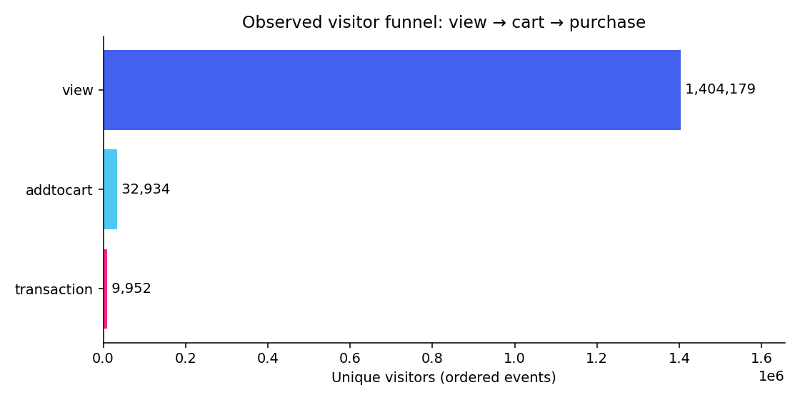
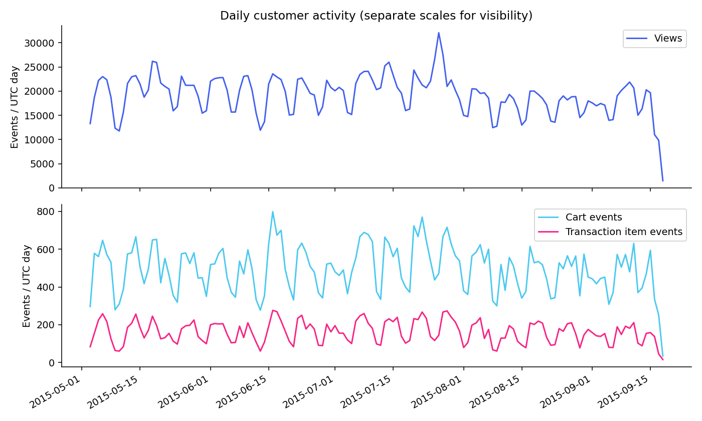
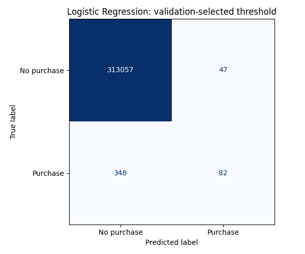
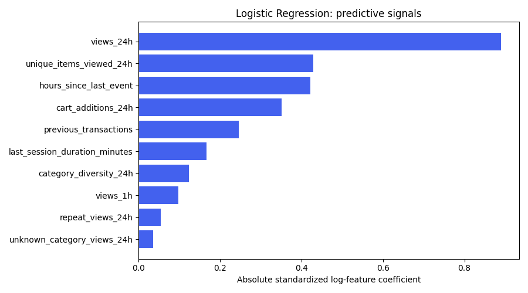

# Results and interpretation

The audited source contains **2,756,101 events** from
**2015-05-03 to 2015-09-18 UTC**, across **1,407,580 visitors**.
Removing 460 exact duplicate rows leaves
**2,755,641 events** for analysis.

- Full-period visitor conversion: **0.83%** (any transaction / any visitor).
- Ordered view → cart → transaction visitors: **1,404,179 → 32,934 → 9,952**.
- 24h cart-event abandonment: **69.87%** across 68,710 eligible cart events.
- Retrospective returning-visitor conversion: **3.50%**, versus **0.53%** for single-day visitors.
- Event-time category coverage: **76.16%**; future metadata is never backfilled.

**1,634,383 visitor-day snapshots** were generated. The held-out test has
**313,534 snapshots**, **430 purchases** and **0.1371% prevalence**.
These snapshot metrics answer a different question from full-period visitor conversion.

| Model | PR-AUC (AP) | ROC-AUC | Precision | Recall | F1 | Precision@1% |
| --- | --- | --- | --- | --- | --- | --- |
| Naive prevalence baseline | 0.0014 | 0.5000 | 0.0000 | 0.0000 | 0.0000 | 0.0006 |
| Logistic Regression | 0.2392 | 0.8858 | 0.6357 | 0.1907 | 0.2934 | 0.0666 |
| Random Forest | 0.2405 | 0.8594 | 0.6406 | 0.1907 | 0.2939 | 0.0625 |

**Logistic Regression** was chosen using validation AP, with its threshold
selected on validation F1. Test Precision@1% is **6.66%**
at **K=3,136**, or **48.6×** test prevalence.
Selecting the top 1% separately each day yields **6.70%** pooled precision.
The threshold produces **82 true positives**, **47 false positives**,
and **348 false negatives**. The approximate 95% day-block bootstrap
interval for selected-model AP is **[0.1996, 0.2890]** (100 replicates).

Boosting status: **Skipped: no usable XGBoost/LightGBM runtime**.
The installed XGBoost wheel could not load its missing macOS OpenMP runtime (`libomp`). Complete parameters, import status and fit times are in
[model_results.json](model_results.json); cohort errors are in
[error_slices.csv](error_slices.csv).

## Figures

## Chronological partitions

| split | rows | positives | first observation UTC | last observation UTC |
| --- | --- | --- | --- | --- |
| train | 978396 | 1359 | 2015-05-05 00:00:00+00:00 | 2015-07-23 00:00:00+00:00 |
| validation | 317104 | 405 | 2015-07-25 00:00:00+00:00 | 2015-08-19 00:00:00+00:00 |
| test | 313534 | 430 | 2015-08-21 00:00:00+00:00 | 2015-09-17 00:00:00+00:00 |
| purged | 25349 | 35 | 2015-07-24 00:00:00+00:00 | 2015-08-20 00:00:00+00:00 |

Purged rows span two separate boundary dates; their min/max are not one continuous excluded interval.

## Category activity

Top categories by transaction item events, with at least 1,000 observed visitors.

| entity | views | carts | transaction_events | visitors | visitor_conversion_rate |
| --- | --- | --- | --- | --- | --- |
| 959 | 43450 | 1425 | 464 | 24030 | 1.37% |
| 1051 | 62365 | 1488 | 421 | 31882 | 0.85% |
| 1483 | 52646 | 1183 | 369 | 35126 | 0.77% |
| 196 | 22702 | 660 | 260 | 14385 | 1.51% |
| 1542 | 10380 | 555 | 248 | 5707 | 3.66% |

Category IDs are anonymized. Category rates are descriptive, with overlapping visitor denominators.

## Business recommendations

1. Audit the high cart abandonment rate, then test a consent-based reminder against a randomized no-reminder holdout. A cart event is not a unique cart; repeated additions can share a later purchase.
2. Use the overnight model to prioritize a small batch for a re-engagement experiment. Compare incremental transactions per eligible visitor and per contact; track unsubscribe or fatigue guardrails if such data can be collected. High propensity alone does not imply persuasion.
3. Inspect high-volume anonymous category IDs and unknown metadata coverage before proposing navigation or product changes. The data does not establish checkout causes or revenue impact.
4. Treat returning-visitor differences as descriptive. Future observed active days cannot be used to define a targeting cohort at an earlier observation time.

## Error analysis and next experiment

See [error_slices.csv](error_slices.csv) for known/new visitors, cart activity, previous purchases and unknown categories. Slices overlap. False positives represent unnecessary contacts under a threshold policy; false negatives represent missed next-day purchasers. F1 is only a transparent offline default until contact costs are known. A next experiment should compare event-triggered or hourly observations with the daily policy in a fresh forward holdout, without retuning on this test.

Class weighting makes raw scores unsuitable as calibrated purchase probabilities. [calibration_bins.csv](calibration_bins.csv) documents the discrepancy. The day-block interval is approximate and does not remove all within-visitor correlation across days.
